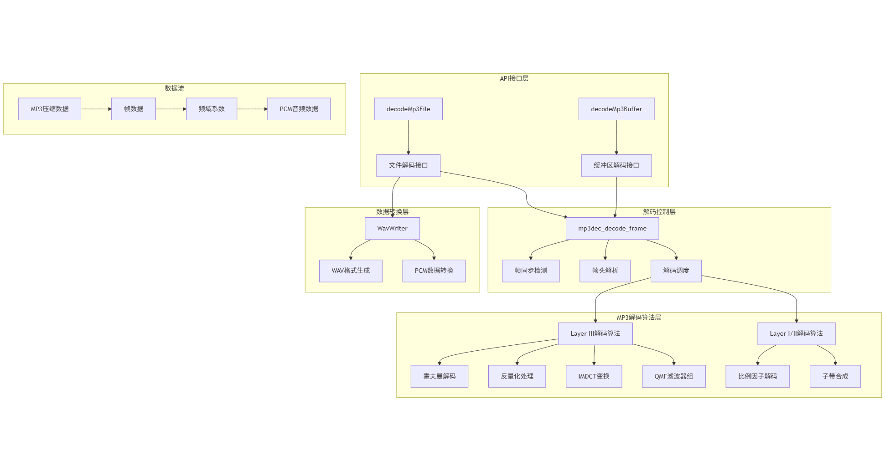
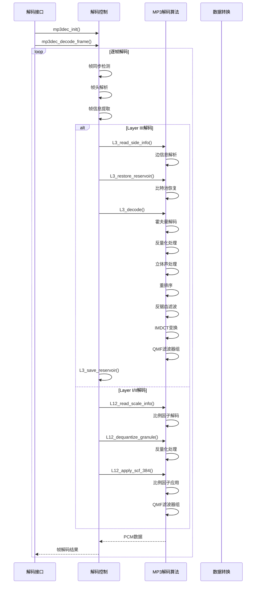

# 库 / 模块 / 类设计介绍

## 描述
    参照minimp3 C库用仓颉语言重新实现，完全遵循MPEG音频标准。
    对外公开函数主要提供decodeMp3File和decodeMp3Buffer两个主要接口，支持文件解码和缓冲区解码两种使用方式；
    内部解码遵循原C项目流程、实现从帧同步检测、帧头解析和音频解码调度，到PCM和WAV输出，包含霍夫曼解码、反量化处理、IMDCT变换、QMF滤波器组等关键算法组件；
    算法采用逐帧处理模式，通过比特池机制支持动态比特率分配，具备完整的立体声处理能力，包括MS立体声和强度立体声。
    整个设计充分利用仓颉语言的特性，且通过宏定义优化帧头解析性能，具备高效、标准兼容、模块化的技术特点。


```

#### 已封装的操作函数

##### `decodeMp3File(inputPath: String, outputPath: String): (Array<Int16>, Int64, Int64)`
解码MP3文件并输出为WAV文件。
- **参数**:
  - `inputPath`: 输入MP3文件路径
  - `outputPath`: 输出WAV文件路径
- **返回值**: `(PCM数据, 采样率, 声道数)`
- **功能**: 完整的MP3到WAV转换，自动处理文件读取和WAV头生成

##### `decodeMp3Buffer(mp3Data: Array<UInt8>): Array<Int16>`
解码MP3二进制数据返回PCM数据。
- **参数**:
  - `mp3Data`: MP3二进制数据数组
- **返回值**: PCM音频数据数组
- **功能**: 纯解码功能，不涉及文件操作

#### 内部解码的主要函数

##### `mp3dec_init(decoder: mp3dec_t): Unit`
初始化MP3解码器。
- **参数**: `decoder` - 解码器实例
- **功能**: 重置解码器状态，准备开始解码

##### `mp3dec_reset(decoder: mp3dec_t): Unit`
重置MP3解码器状态。
- **参数**: `decoder` - 解码器实例
- **功能**: 清除解码器内部缓冲区，重置到初始状态

##### `mp3dec_decode_frame(decoder: mp3dec_t, mp3: Array<UInt8>, mp3_bytes: Int64, pcm: Array<Int16>, info: mp3dec_frame_info_t): Int64`
解码一帧MP3数据。
- **参数**:
  - `decoder`: 解码器实例
  - `mp3`: MP3数据缓冲区
  - `mp3_bytes`: 数据长度
  - `pcm`: PCM输出缓冲区
  - `info`: 帧信息输出
- **返回值**: 解码的样本数
- **功能**: 核心解码函数，处理单帧MP3数据

## 架构图

### 依赖关系



### 架构图设计描述



## 展示示例

```cangjie
import minimp3_cj.*

// 方法1: 直接解码MP3文件为WAV文件
let (pcmData, sampleRate, channels) = decodeMp3File("input.mp3", "output.wav")
println("解码完成！采样率: ${sampleRate} Hz, 声道数: ${channels}")

// 方法2: 解码MP3二进制数据
let mp3Data = File.readFrom("sample/demo.mp3")
let mp3Bytes = Array<UInt8>(Int64(mp3Data.size), {k: Int64 => UInt8(mp3Data[k])})
let pcmData = decodeMp3Buffer(mp3Bytes)
println("解码得到 ${pcmData.size} 个PCM样本")
```

```bash
# 运行所有测试
cjpm test

# 运行特定测试
# 二进制解码测试
cjpm test --filter=MP3PCMTests.testDecodeMp3Buffer

# 文件解码为wav输出测试
cjpm test --filter=MP3PCMTests.testDecodeMp3File
```
