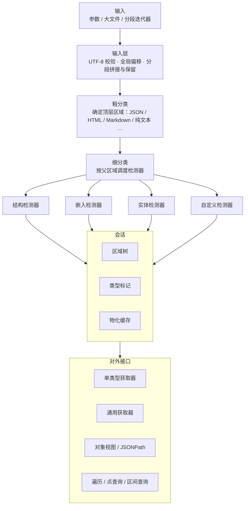

# RawPrism 库设计文档

## 描述

RawPrism 是纯仓颉实现的多模态文本扫描分类基础库。读入一段文本，识别其中混合的结构化内容（JSON、NDJSON、YAML、TOML、CSV、XML、HTML、Markdown）、非结构化内容（纯文本）与实体（URL、邮箱），用相对整段输入起点的偏移区间 `[start, end)` 标注类型，形成区域树；再通过获取器按类型取出结果，或派生统一 Object 视图（支持 RFC 9535 JSONPath）。

输入在会话内只读，识别结果均为对输入的区间引用；同一类型在同一区间上至多检测一次；区域仅在被请求时物化。定位：多模态 AI 应用中的文本侧基础库——负责文本层的扫描、分类与有界物化；不处理二进制模态，不做语义分析，不发起网络请求。

## 架构设计

### 包结构

| 包 | 源码目录 | 职责 |
|----|----------|------|
| `rawprism` | `src/`（根级文件） | 会话（`Session`）、检测器/获取器接口与注册表、内置检测器与获取器、并发扫描入口 |
| `rawprism.core` | `src/core/` | 核心数据契约：区间（`Span`）、类型标识（`TypeId`）、区域与区域树（`Region`/`RegionTree`）、类型标记（`TypeMark`）、输入层（`Input`/`ChunkSource`）、扫描配置（`ScanConfig`/`ParseLimits`） |
| `rawprism.parse` | `src/parse/` | 各格式解析器：json、ndjson、yaml、toml、csv、xml_html、markdown，均带原文偏移与资源上限 |
| `rawprism.object` | `src/object/` | 统一 Object 视图（`Obj` 及 6 种值类）、JSONPath（RFC 9535）查询 |
| `rawprism.test` | `src/test/` | 单元/一致性/并发/基准测试套件 |

### 依赖方向

```
应用代码（实现 Detector / Getter<T>）
   │
   ▼
Session（会话，src/session.cj）
   │
   ├──► Input（输入层，src/core/input.cj）── 参数 / 大文件 / 分段三种来源
   ├──► RegionTree（区域树，src/core/region.cj）
   ├──► TypeMark（类型标记，src/core/core.cj）── 每类型的覆盖区间与状态
   ├──► GetterRegistry（注册表，src/detector.cj）── 依赖拓扑排序
   │        │
   │        ▼
   │    Detector / Getter<T>（src/detector.cj）
   │        │
   │        ▼
   │    内置检测器（src/builtin.cj）──► 解析器（src/parse/*）
   │
   └──► Obj / jsonPath（对象视图，src/object/）── 惰性物化并缓存

关键约束：
- rawprism.core 不依赖其他层；rawprism.parse、rawprism.object 只依赖 rawprism.core；
- rawprism（根包）依赖以上三包；
- 主包无任何外部模块依赖（`cjpm.toml` 不含 `[dependencies]`）。
```

### 核心组件

#### Session（会话）

对一个输入的扫描状态容器，持有区域树、按类型的标记表与物化缓存。`scan()` 先做粗分类确定顶层区域类型（合法 JSON → `struct.json`；HTML 文档 → `markup.html`；Markdown 形状 → `text.md`；否则 `text.plain`），再按注册表依赖序对每个检测器类型执行按需扫描。对外提供：

- 获取：`getAll(selectors)`、`first(selectors)`、`typeCounts()`、`regionsOf(typeIdText)`
- 查询：`walk(visitor)`（混合类型遍历）、`chainAt(offset)`（点查询）、`intersecting(span)`（区间查询）
- 物化：`objectOf(region)`（惰性构建 Object 并缓存）
- 扩展：`prescan<T>(key, compute)` 共享预扫描，同一信息在一次输入上只计算一次
- 报告：`truncated` 截断标记、`retainedBytes()`/`droppedSpans()`/`fullyRetained()` 输入保留状态

#### Input（输入层）

只读输入存储（约束 C1：不暴露可写存储，副本须显式 `toBytes()`/`toText()` 请求）。三种输入方式统一为全局偏移空间（约束 C2）：

| 方式 | 构造 | 说明 |
|------|------|------|
| 参数输入 | `Input(text)` / `Input(bytes)` | 整段文本一次给出 |
| 大文件输入 | `Input.fromFile(path)` | 按固定字节块顺序读取，不整体载入；可重读来源物化时按区间重读，分配长度以来源实际长度为上界（不由调用方区间决定） |
| 分段输入 | `Input(ChunkSource)` | 调用方按序产出分段，边界可落在任意位置（含多字节字符内部）；按需拉取；受 `retentionLimit` 保留上限约束，超限丢弃头部区间并可报告 |

非法 UTF-8 按策略处理：`UTF8Policy.Strict` 报错，`UTF8Policy.ErrorRegion` 登记后继续（物化时以 U+FFFD 替换）。

#### Detector / Getter<T> / GetterRegistry

`Detector` 声明 `typeId`（产出类型）、`within`（可运行的父区域选择器）、`dependsOn`（前置类型）、`authoritative`（权威性类型），实现 `detect(scope, ctx)`；`Getter<T>` 在 Detector 之上增加 `materialize(region, ctx): T`。`DetectContext` 提供输入读取、区域产出（`emit`）、副产物登记（`addCandidate`/`emitAuthoritative`，约束 C4）、否定/错误区间登记与取消检查。`GetterRegistry` 按 `dependsOn` 拓扑排序并拒绝循环依赖。

#### TypeMark（类型标记）与单次扫描

每个类型在会话中记录已覆盖区间、已登记区域、候选/否定/错误区间与状态（未扫描/部分/完成）。请求类型 T 在区间 R 上的结果时，只在 R 中未被覆盖的部分运行 T 的检测器，候选区间优先验证（约束 C3：同一类型同一区间至多检测一次）。

#### Obj（统一对象视图）

`Obj` 抽象类 + 6 种值类（`ObjNull`/`ObjBool`/`ObjNumber`/`ObjText`/`ObjSeq`/`ObjMap`），来源包括 JSON、YAML、XML/HTML DOM、CSV、TOML 与 front matter。节点默认是引用输入的视图（只存区间），按键/下标/点分路径访问，`walk` 带控制深度遍历，`sourceSpan()` 反查原文区间，`toOwned()` 显式复制为独立结构。`jsonPath(root, query)` 提供 RFC 9535 查询。

## 架构图



## 内置类型

| 类别 | TypeId | 说明 |
|------|--------|------|
| 结构 | `struct.json`、`struct.ndjson`、`struct.yaml`、`struct.toml`、`struct.csv`、`struct.xml` | 严格解析与有界试解析；可派生 Object |
| 标记 | `markup.html`，子类型 `#script`、`#style`、`#text`、`#table`、`#meta` | 容错 HTML 解析；可派生 Object |
| 文本 | `text.plain`、`text.md`，子类型 `.heading`、`.paragraph`、`.code`、`.table`、`.frontmatter` | Markdown 结构区域 |
| 代码 | `code.block[lang=...]` | 围栏代码块；lang 为 json/yaml/toml/csv 时可派生 Object |
| 实体 | `entity.url`、`entity.email` | 文本中的实体；HTML href/src、JSON 字符串值中的 URL 作为副产物登记 |
| 自定义 | 用户声明的 TypeId | 实现 `Detector`/`Getter<T>`（只需 `typeId` 与 `detect`，其余属性有默认实现）注册即用 |

TypeId 是层级名，选择器支持精确名（`struct.json`）、前缀（`text.md`）、通配（`text.*`）、子类型限定（`markup.html#text`）与参数限定（`code.block[lang=json]`）。

## 依赖关系

- `rawprism` 仅依赖仓颉标准库（`std.collection`、`std.sync`、`std.time`、`std.fs`、`std.io`），无第三方依赖、无 C 依赖、无中心仓制品依赖
- 不需要 `stdx`，因此无平台相关的 `bin-dependencies` 配置

## 并发

- `scanAsync(input)` 异步扫描入口，返回 `Future<Session>`，由调用方决定何时等待
- `scanConcurrent(session)` 按 `config.parallelism` 并行调度独立检测器类型；为保证与串行结果逐字节一致（确定性约束 C5），当前按注册序执行
- 同一类型同一区间的并发请求只触发一次检测（会话锁串行化按需扫描）
- `cancelScan(session)` 发出取消请求；`timeBudgetMs` 时间预算超时返回已有结果并带截断标记

## 设计约束

- C1 只读：输入在会话内不可被修改，对外不暴露可写输入存储
- C2 偏移稳定：所有区间相对整个输入起点（UTF-8 字节），分段/裁剪后仍稳定
- C3 单次扫描：同一类型同一区间至多检测一次
- C4 副产物登记：检测中观察到的其他类型必须登记供复用
- C5 确定性：相同输入与检测器集合产生相同区域树，与并发度、分段方式无关
- C6 惰性物化：区域只在被请求时物化，结果可缓存
- C7 资源有界：深度、结构长度、区域数量、物化大小、时间预算均可配置，超限返回带截断标记的部分结果
- 健壮性：解析器深度设上限不栈溢出；YAML 别名展开次数有上限；XML 不解析外部实体；畸形输入不使会话失败（记为错误区间）；物化分配不信任调用方区间；JSONPath `match()/search()` 的正则实参限为字面量（被扫描内容不决定模式）
