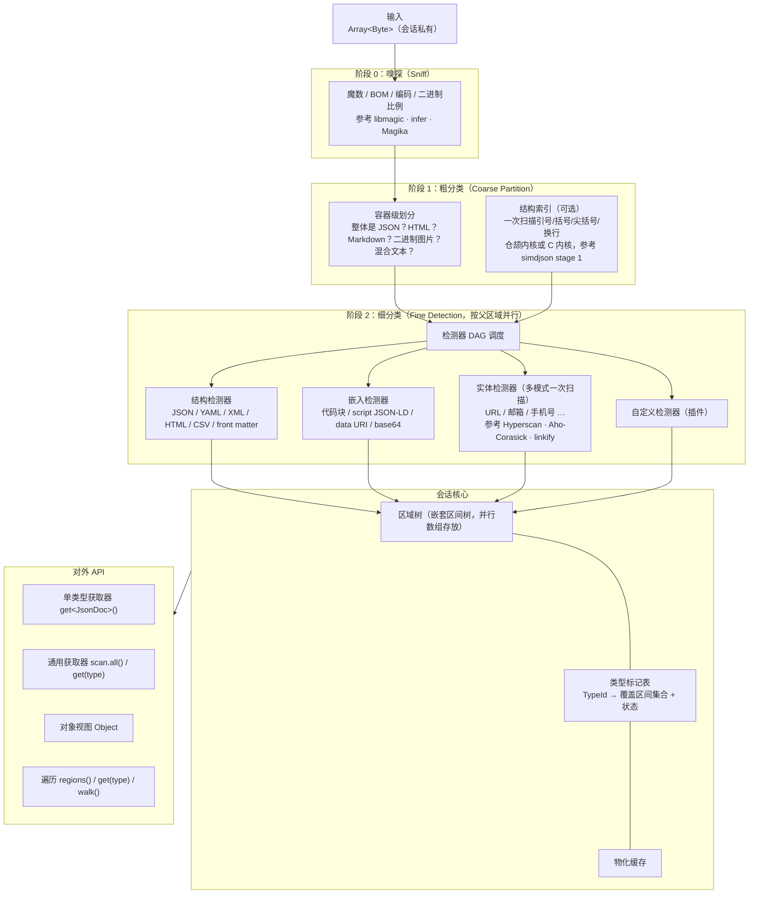

# 高性能扫描分类器设计：RawPrism

| 项 | 内容 |
|---|---|
| 文档状态 | 草案 |
| 日期 | 2026-10-18 |
| 项目名 | **RawPrism**，仓库 `MistLoom/RawPrism`，cjpm 模块名 `rawprism` |
| 实现语言 | 仓颉（Cangjie）1.0.x LTS，见第 12 节 |

---

## 0. 项目名

**RawPrism**：棱镜把一束光分解成光谱，但不改变光本身。本项目对一段原始数据做同样的事：识别其中混合的 JSON、HTML、Markdown、URL、图片等类型，以偏移区间标出位置，**不改动、不移除任何字节**。

名称中的 Raw 强调处理对象是原始数据。cjpm 模块名（同时是 root 包名）用 `rawprism`。子包按目录命名为 `rawprism.core`、`rawprism.detect.json` 等，见 12.2。

---

## 1. 定位与目标

### 1.1 定位

RawPrism 是一个**只读的、单次扫描的结构识别与分类库**。输入任意原始字节（网页、接口响应、文档、日志、混合文本），输出一棵**类型化区间树**，并提供统一的获取器（Getter）接口，以目标格式（Markdown、图片、JSON、YAML、HTML、对象、文本、URL 等）取出数据。

RawPrism 可以作为独立小项目发布，供任何需要"先弄清楚这段数据里有什么"的系统使用，包括采集器、ETL、日志分析、LLM 预处理等。

### 1.2 目标

1. 识别原始数据中的结构化数据（JSON、YAML、XML/HTML、CSV、front matter、JSON-LD 等）和非结构化数据（自然语言文本、Markdown 段落），以及嵌入的多媒体（data URI、base64 图片、图片二进制）和实体（URL、邮箱、手机号等）。
2. 通过**单类型获取器**或**通用获取器**取得目标格式。
3. 提供统一的**对象（Object）**视图，消解 JSON、YAML、XML/DOM 等结构的差异。
4. 不篡改数据：所有结果都是对原始缓冲区的区间引用。
5. 同一份数据中的同一类型只扫描一次：扫描中发现的类型都做标记并缓存。
6. 支持混合类型遍历和按类型遍历。
7. 支持自定义获取器，并能嵌套其他获取器。
8. 并发扫描，尽量零拷贝。

### 1.3 非目标

1. 不做格式转换的"渲染"。例如 HTML 转 Markdown 由上层适配器完成；RawPrism 只提供定位和原样切片，或者轻量的规范化视图（见第 9 节）。
2. 不做语义理解，例如情感分析或实体消歧。
3. 不负责网络获取和文件格式解包（例如 PDF、Office 文档）。它们可以作为外部前置步骤，产出的文本再交给 RawPrism（参考 Apache Tika 的定位）。
4. 不保证对恶意构造输入的完整解析，但保证资源有界（见第 10.4 节）。

---

## 2. 术语

| 术语 | 定义 |
|---|---|
| 缓冲区（Buffer） | 会话持有的一段原始字节（`Array<Byte>`），对外只以只读视图 `ByteView` 暴露 |
| 区间（Span） | `[start, end)` 字节偏移对，始终相对于根缓冲区 |
| 区域（Region） | 一个 Span 加上类型 ID、置信度、属性和子区域，是分类结果的基本单元 |
| 区域树（Region Tree） | 按包含关系组织的区域嵌套树（一种区间树） |
| 类型（TypeId） | 层级化的类型标识，例如 `struct.json`、`markup.html`、`text.md`、`media.image.png`、`entity.url` |
| 检测器（Detector） | 实现某种识别逻辑的单元，在给定区间内产出区域 |
| 获取器（Getter） | 面向用户的接口：声明需要的类型，返回区域及其物化结果。获取器内部组合一个或多个检测器 |
| 扫描会话（Scan Session） | 对一个缓冲区的扫描状态容器，持有区域树、类型标记和缓存 |
| 类型标记（Mark） | 某类型在某区间上的扫描完成状态 |
| 对象（Object） | 统一的、可枚举的树形值视图，从 JSON/YAML/XML 等区域派生 |
| 物化（Materialize） | 把区域转换成目标表示（切片、解码文本、对象视图、解码后的图片字节） |

---

## 3. 核心不变量

| # | 不变量 | 保证方式 |
|---|---|---|
| I1 | **只读** | 输入数组由会话私有持有；对外只提供没有写操作的 `ByteView`，需要副本时显式复制；区域只记录 Span |
| I2 | **偏移稳定** | 所有 Span 都是根缓冲区上的字节偏移，嵌套区域也一样；字符偏移、行列号按需派生 |
| I3 | **单次扫描** | 同一会话中，某检测器对某区间至多执行一次；结果写入类型标记和缓存，后续获取直接命中 |
| I4 | **副产物登记** | 检测器顺带观察到的类型必须登记（例如 JSON 解析器发现字符串值看起来像 URL 时，登记"候选区间"），避免重复扫描 |
| I5 | **确定性** | 相同输入加相同检测器集合，输出的区域树和遍历顺序完全一致，与线程数无关 |
| I6 | **惰性物化** | 区域只有在被请求时才物化；物化结果按区域缓存；字符串转义解码等需要分配的操作只在请求时进行 |
| I7 | **资源有界** | 扫描深度、区域数量、单次物化大小、时间预算都有上限，超限时返回部分结果并标注 |

---

## 4. 架构



---

## 5. 扫描流程

### 5.1 阶段 0：嗅探

- 检查 BOM 和魔数（PNG、JPEG、GIF、WebP、PDF、ZIP、gzip 等），判断二进制还是文本（统计不可打印字节比例）。
- 编码判定顺序：BOM → 外部提示（例如 HTTP charset）→ UTF-8 合法性快速校验（扫描内核，见 10.1）→ 启发式（GB18030、Shift_JIS 等）。
- **编码不改变原始字节**：非 UTF-8 文本会建立一个"解码视图"，并保留解码视图与原始字节之间的偏移映射表。所有对外的 Span 仍是原始字节偏移。
- 可选：接入基于模型的内容类型识别（参考 Google Magika）作为低置信度时的补充。

### 5.2 阶段 1：粗分类

确定根缓冲区的**容器类型**，并划出一级区域：

| 情况 | 结果 |
|---|---|
| 整体是合法 JSON | 一个 `struct.json` 根区域 |
| HTML 文档 | 一个 `markup.html` 根区域；`<script>`、`<style>`、`<pre>`、`<template>` 等划为子区域候选 |
| Markdown | 一个 `text.md` 根区域；front matter、代码块、表格、HTML 块划为子区域 |
| 二进制媒体 | 一个 `media.*` 根区域，不再细分 |
| 混合文本（日志、聊天、LLM 输出） | 一个 `text.plain` 根区域；用结构索引寻找可能的 JSON/YAML/XML 起点 |

结构索引借鉴 simdjson 的两阶段思路：先由扫描内核一次性找出所有结构字符（`{}[]":,<>` 和换行）的位置，生成位图（`Array<UInt64>`）或位置数组（`Array<Int64>`）；后续各个结构检测器共享这份索引，不再逐字节扫描。

### 5.3 阶段 2：细分类

细分类在每个父区域内执行。检测器声明自己接受的父类型（`within`），调度器只在匹配的区域上运行它：

```text
text.md
 ├─ struct.yaml        (front matter)      within: text.md@head
 ├─ code.block[lang=json]                   within: text.md
 │   └─ struct.json                         within: code.block[lang=json]
 ├─ markup.html        (HTML 块)            within: text.md
 │   └─ entity.url                          within: markup.html@attr(href|src)
 ├─ text.md.paragraph
 │   ├─ entity.url
 │   └─ entity.email
 └─ media.image.ref    ( 引用)
```

**嵌入候选的验证**：混合文本中看起来像 JSON 的片段（例如 `{` 开头），由 JSON 检测器做"有界试解析"（最大长度和深度受限），成功才登记为区域，失败只记一个负标记（`checked-negative`），防止其他检测器再试一次。

### 5.4 嵌套区间树

- 区域按 `(start asc, end desc)` 排序存放在区域表的并行数组中（10.2），父子关系用索引表示，不用对象引用。
- **约束**：子区域必须被父区域完全包含；同级区域可以重叠，但必须标记 `overlap=true`，例如 URL 实体与 Markdown 链接语法的重叠。
- **查询**：
  - 点查询（某偏移属于哪些区域）和区间查询（与某区间相交的区域）用增广区间树，复杂度 O(log n + k)；
  - 按类型查询走类型索引（第 6 节）。
- 区域树一旦冻结（会话完成某轮扫描）就只能追加，不能修改，从而支持无锁并发读取。

---

## 6. 类型标记与索引缓存

### 6.1 类型标记表

每个会话维护：

```cangjie
public enum MarkState {
    Unscanned | Partial | Complete
}

public class MarkEntry {
    let coverage = RangeSet()                  // 已检测过的区间集合（无论有没有命中）
    var state = MarkState.Unscanned
    let regions = ArrayList<RegionId>()        // 已登记的区域（按 start 排序）
    let candidates = RangeSet()                // 副产物登记的候选区间（尚未验证）
    let negatives = RangeSet()                 // 验证失败的区间
}

// MarkTable：HashMap<TypeId, MarkEntry>，并发访问方式见 10.1
```

### 6.2 获取时的决策

1. 请求 `get(T, range)`：计算 `range − coverage[T]`，得到未覆盖区间。
2. 未覆盖区间为空时，直接返回 `regions[T]` 中与 `range` 相交的部分，**零扫描**。
3. 否则只在未覆盖区间上运行 T 的检测器，优先验证 `candidates[T]`。执行后把这些区间并入 `coverage[T]`，状态由 `Partial` 转为 `Complete`。

### 6.3 副产物登记

扫描过程中天然会观察到其他类型，例如：

- JSON 检测器遍历字符串时可以顺便判断是否以 `http://` 或 `https://` 开头；
- HTML 检测器在解析属性时直接知道 `href` 和 `src` 的值区间；
- Markdown 检测器知道链接和图片语法的位置。

检测器通过 `ctx.observe(type, span, confidence)` 登记这些发现：

- 如果检测器对该类型在该区间具有**权威性**（`authoritative` 中列出该类型），直接写入 `regions` 并更新 `coverage`；
- 否则写入 `candidates`，由该类型的权威检测器后续快速验证。

这样，"扫描时已经知道但没有记录"的信息不会被浪费，同一类型也不会被不同获取器重复扫描。

### 6.4 跨会话缓存（可选）

区域树和类型标记可以序列化为紧凑格式（Span 数组 + 类型表），按缓冲区内容哈希缓存。上层系统可以持久化这份结果，下次加载时跳过扫描。序列化格式带检测器集合的版本号，版本不同则缓存失效。

---

## 7. 获取器接口

接口以仓颉代码示意，只列出签名与关键实现，省略部分构造函数与函数体。`Span`、`Region`、`ByteView`、`Found<T>` 为值类型 `struct`，`Session`、注册表等为引用类型 `class`。

### 7.1 基础类型

```cangjie
package rawprism.core

import std.deriving.*

public type TypeId = String                       // 层级名，例如 "struct.json"
public type RegionId = Int32

@Derive[Equatable, Hashable, ToString]
public struct Span {
    public let start: Int64                       // 根缓冲区字节偏移（含）
    public let end: Int64                         // 根缓冲区字节偏移（不含）
    public init(start: Int64, end: Int64) {
        this.start = start
        this.end = end
    }
    public prop size: Int64 {
        get() { end - start }
    }
}

public struct Region {                            // 读取时由区域表构造的值视图
    public let id: RegionId
    public let typeId: TypeId
    public let span: Span
    public let parent: ?RegionId
    public let confidence: Float32                // 0..1
    public let attrs: Attrs                       // 例如 lang=json、charset、mime（会话内共享的只读映射）
    public let overlap: Bool
}

public struct ByteView {                          // 只读视图：根缓冲区引用 + 区间，不复制
    private let root: Array<Byte>                 // 会话输入，不对外暴露
    public let span: Span                         // 相对根缓冲区的偏移
    init(root: Array<Byte>, span: Span) {         // 包内构造
        this.root = root
        this.span = span
    }
    public prop size: Int64 {
        get() { span.size }
    }
    public operator func [](i: Int64): Byte {     // i 相对 span.start；越界由运行时检查
        root[span.start + i]
    }
    public func sub(s: Span): ByteView {          // 子视图，与输入共享存储；s 必须落在 span 内
        ByteView(root, s)
    }
    public func text(s: Span): String {           // 物化为 String（复制并校验 UTF-8）
        String.fromUtf8(root.slice(s.start, s.size))
    }
    public func toArray(): Array<Byte> {          // 显式复制，唯一的字节复制出口
        root.clone(span.start..span.end)
    }
}

public interface ScanSession {
    func buffer(): ByteView                       // 只读
    func slice(span: Span): ByteView              // 零拷贝视图
    func regions(): Iterator<Region>              // 全部区域，前序深度优先
    func marks(typeId: TypeId): MarkInfo
}
```

### 7.2 单类型获取器

```cangjie
package rawprism.detect

public enum Cost {
    Cheap | Medium | Expensive
}

public interface Detector {
    prop id: TypeId                               // 产出的主类型
    prop dependsOn: Array<TypeId>                 // 需要先完成的类型（粗分类）
    prop within: Array<TypeSelector>              // 只在这些父区域内运行；空表示整个缓冲区
    prop authoritative: Array<TypeId>             // 对哪些类型有权威性（副产物直接落区域）
    prop cost: Cost                               // 调度参考
    // 通过 ctx.emit / ctx.observe 产出区域草稿和副产物
    func detect(view: ByteView, scope: Span, ctx: DetectCtx): Unit
}

public interface Getter<T> <: Detector {
    func materialize(region: Region, view: ByteView, opts: MatOpts): T
}

// 用户侧
let jsons: Iterator<Found<JsonDoc>> = session.get<JsonDoc>()
let urls = session.get<Url>(within: "text.md")
let html: ?Found<HtmlDoc> = session.first<HtmlDoc>()
```

`Found<T>` 是 `struct`，包含 `region` 和惰性的 `value()`。只访问 `region` 时不会触发物化。

### 7.3 通用获取器

```cangjie
public interface UniversalGetter {
    func all(opts: TraverseOpts): Iterator<Found<Any>>                     // 混合类型遍历，按位置顺序
    func get(sel: TypeSelector, opts: TraverseOpts): Iterator<Found<Any>>  // 动态类型选择
    func kinds(): Array<KindInfo>                                          // 类型清单：typeId、count、coverage
    func materializeAs(target: Format, region: ?RegionId): Any             // 以目标格式取出
}

public enum Format {
    Md | Image | Json | Yaml | Html | Xml | Object | Text | Url | Bytes | Custom(TypeId)
}
```

`materializeAs(target)` 的规则：

- 区域本身就是目标类型时，直接返回原样切片或其视图。
- 存在明确的视图转换时提供只读视图，例如 JSON、YAML、XML 转 `Object`，HTML 转 `Text`（文本节点拼接视图）。视图带"源区间映射"，可以反查原文位置。
- 有损或需要生成新文本的转换（例如 HTML 转 Markdown）不属于 RawPrism 内置能力，需要用户注册转换器，结果明确标注为派生数据。

### 7.4 自定义获取器

```cangjie
import rawprism.core.*
import rawprism.detect.*
import rawprism.macros.*

// @Detector 属性宏由 rawprism.macros 提供，按属性生成 Detector 接口的 prop 实现
@Detector[id = "entity.phone.cn",
          within = ["text.*", "markup.html#text", "struct.*#string"],
          authoritative = ["entity.phone.cn"],
          cost = Cheap]
public class PhoneCn <: Getter<String> {
    public func detect(view: ByteView, scope: Span, ctx: DetectCtx): Unit {
        for (m in ctx.patterns("phone_cn").scan(view, scope)) {          // 共享多模式引擎
            ctx.emit(RegionDraft("entity.phone.cn", m.span, 0.9))
        }
    }

    public func materialize(r: Region, view: ByteView, opts: MatOpts): String {
        normalizeE164(view.text(r.span))                                  // 物化可以规范化，原文不变
    }
}

registry.register(PhoneCn())
```

- 注册后可以通过 `session.get("entity.phone.cn")` 或通用获取器 `all()` 使用。
- `@Detector[...]` 是 `rawprism.macros` 中的属性宏，按属性生成 `Detector` 接口的 `prop` 实现；不使用宏时，直接在类中实现这些 `prop`。
- 自定义获取器可以向共享的**多模式引擎**注册正则或字面量。所有实体类获取器的模式编译到同一个自动机，一次扫描同时匹配（参考 Hyperscan/Vectorscan 的多模式匹配，以及 Aho-Corasick 的字面量预筛）。

### 7.5 嵌套获取器

获取器可以组合其他获取器，实现"先粗分类、再细分类"：

```cangjie
@Detector[id = "dataset.product-list", dependsOn = ["markup.html", "struct.json"]]
public class ProductList <: Detector {
    public func detect(view: ByteView, scope: Span, ctx: DetectCtx): Unit {
        // 1) 复用已有结果：页面内的 JSON-LD 和接口 JSON
        for (j in ctx.get("struct.json", within: ["markup.html#script[type=ld+json]", "root"])) {
            let obj = j.object()
            if (obj.queryFirst("$..[?@['@type']=='Product']").isSome()) {
                ctx.emit(RegionDraft("dataset.product-list", j.region.span, 0.8))
            }
        }
        // 2) 再看 HTML 表格
        for (t in ctx.get("markup.html.table")) {
            // …
        }
    }
}
```

嵌套获取器通过 `ctx.get` 读取其他类型。这些调用同样遵守单次扫描和缓存规则，因此嵌套不会导致重复扫描。调度器根据 `dependsOn` 构建 DAG，并检测循环依赖。

### 7.6 内置获取器

| 类别 | TypeId | 说明 |
|---|---|---|
| 结构 | `struct.json`、`struct.ndjson`、`struct.yaml`、`struct.toml`、`struct.csv`、`struct.xml`、`struct.jsonld` | 严格解析和有界试解析 |
| 标记 | `markup.html`（及 `#script`、`#style`、`#text`、`.table`、`.meta`）、`markup.svg` | 容错 HTML 解析（参考 html5ever、lol-html） |
| 文本 | `text.plain`、`text.md`（及 `.heading`、`.paragraph`、`.code`、`.table`、`.frontmatter`） | Markdown 事件流（参考 pulldown-cmark、markdown-it） |
| 代码 | `code.block[lang]` | 语言识别可选接入 tree-sitter |
| 媒体 | `media.image.{png,jpeg,gif,webp,svg}`、`media.datauri`、`media.base64` | 只做定位和头部解析（宽高）；解码按需进行 |
| 实体 | `entity.url`、`entity.email`、`entity.phone`、`entity.ip`、`entity.hash`、`entity.date` | 多模式引擎；URL 规则参考 linkify |

---

## 8. 对象模型

### 8.1 设计目标

`Object` 是一种统一的、可枚举的树形值视图，用于在"部分数据是 JSON、部分是 XML、部分是 YAML"的情况下使用同一套方法处理数据。它参考以下成熟设计：

- `serde_json::Value`：枚举式的动态值类型；
- simdjson On-Demand：惰性、按需解析的游标式访问；
- jq：路径和管道操作语义；
- JSONPath（RFC 9535）：标准化的查询语法。

### 8.2 值类型

```cangjie
package rawprism.object

public enum Value {
    Null
    | Boolean(Bool)
    | Number(NumberRepr)          // 保留原文区间，按需解析为 Int64 / UInt64 / Float64 / Decimal，避免精度损失
    | Text(StrRepr)               // 原文区间 + 是否含转义；无转义时直接引用原文
    | Sequence(NodeList)
    | Mapping(NodeMap)            // 保持源顺序；允许重复键（以列表保存，提供 first / all 访问）
}

public struct Origin {
    public let region: RegionId
    public let span: Span
    public let sourceType: TypeId
}

public class Node {
    public let value: Value
    public let origin: Origin     // 每个节点都可以回溯原文
    public let tag: ?String       // 源格式的类型标签（YAML tag、XML 元素名）
}
```

### 8.3 源格式映射规则

| 源格式 | 映射 |
|---|---|
| JSON | 一一对应 |
| YAML | 标量按 YAML 1.2 Core Schema 推断类型；锚点和别名展开为共享节点（引用，不复制）；多文档映射为 Array；`tag` 保留 |
| XML / HTML DOM | 元素 → Map：`@name` 表示属性，`#text` 表示文本，子元素按名称聚合，同名多次出现时为 Array，顺序另保留在 `#children`；`tag` 为元素名。约定与常见的 XML→JSON 约定（例如 xmltodict 的 `@`、`#text`）一致 |
| CSV | Array of Map（有表头）或 Array of Array |
| TOML | 一一对应，日期时间保留原文并标注 `tag=datetime` |
| front matter | 按其内部格式（YAML/TOML/JSON）映射 |

映射规则可以配置，例如 XML 属性前缀、是否强制数组。规则版本记录在对象元数据中。

### 8.4 操作

```cangjie
obj.get("a")?.get(0)?.asStr()
obj.path([Key("items"), Index(3), Key("title")])
obj.query("$.items[?@.price < 10].title")          // RFC 9535 JSONPath，返回 Iterator<Node>
obj.queryFirst("$.items[0]")                       // ?Node
for ((k, v) in obj.entries()) { … }                // 统一枚举
obj.walk({ path, node => WalkAction.Continue })    // Continue | Skip | Stop
obj.origin(path)                                   // Span，回溯原文
obj.toOwned()                                      // 显式拷贝成独立结构（唯一会复制的出口）
```

`Object` 默认是引用原文的视图，节点保存 Span，不复制原文。视图可以跨线程只读共享；需要长期保存少量结果而不保留整个输入时，用 `toOwned()` 复制出独立结构。

---

## 9. 遍历 API

```cangjie
// 混合类型遍历（通用获取器）：按位置前序
for (r in session.all(TraverseOpts(order: Position))) { … }

// 按层级遍历
for (r in session.roots()) {
    for (c in session.children(r)) { … }
}

// 某一类型（可能有多个）
for (u in session.get("entity.url")) { println(u.value()) }

// 限定父区域与深度
session.get("struct.json", within: "text.md.code", maxDepth: 2)

// 区间查询
session.at(offset)                 // 包含该偏移的区域链（从外到内）
session.overlapping(span)          // 与区间相交的区域

// 访问者模式
session.walk(visitor)              // visitor 实现 Visitor 接口：enter(region): WalkAction，leave(region): Unit

// 类型清单
session.kinds()  // [KindInfo("text.md", 1), KindInfo("struct.yaml", 1), KindInfo("entity.url", 14), …]
```

遍历顺序在不变量 I5 下确定：位置升序，同一起点时外层优先，再按 TypeId 字典序。

---

## 10. 并发模型与内存模型

### 10.1 并发模型

RawPrism 使用仓颉线程。仓颉线程是运行时管理的用户态轻量级线程，采用 M:N 模型调度到 native 线程上执行，支持抢占；`spawn` 创建线程并返回 `Future<T>`，`get()` 等待结果并重新抛出线程内的异常 [D5][D6]。

| 层次 | 并行方式 |
|---|---|
| 检测器级 | 检测器 DAG 中无依赖关系的检测器各以一个 `spawn` 任务执行，调度器对 `Future<ArrayList<RegionDraft>>` 调用 `get()` 汇合 |
| 区域级 | 同一检测器在多个父区域上并行，例如 100 个代码块分别做 JSON 解析，每个父区域一个任务 |
| 分块级 | 大缓冲区（默认大于 4 MiB）上的行级或实体级检测器按块并行。块之间重叠 `maxPatternLen` 字节，结果按 Span 去重，保证跨块边界的实体不丢失 |
| 并行度 | 会话级 `Semaphore` 限制同时运行的扫描任务数（`maxParallel`，默认等于配置的工作并行度）[D7] |
| 向量级 | 嗅探、UTF-8 校验、结构字符索引、换行定位是独立的扫描内核：默认以仓颉实现的紧凑循环；自定义编译条件 `rawprism_native == "on"` 时改用 C 内核，经 C FFI 调用（10.2 第 7 条）[D21] |
| 会话级 | 多个缓冲区的会话完全独立，可以批量并行 |
| I/O | RawPrism 本身不做 I/O。`scanAsync` 把扫描放进 `spawn` 任务并返回 `Future<ScanResult>`，调用方自行决定何时 `get()` |

**确定性合并**：每个任务把区域草稿写入自己的 `ArrayList`，作为 `Future` 的返回值交回调度器，任务之间不共享可变状态。每个阶段结束时，调度器按 `(start, end, type)` 排序后合并进区域表。因此输出与线程调度无关。

**同步原语**（`std.sync` 与 `std.collection.concurrent`）[D7][D8]：

- **single-flight**：会话持有 `ConcurrentHashMap<MarkKey, Future<Unit>>`，键为 `(TypeId, 区间)`。第一个请求者登记 `spawn` 返回的 `Future` 并执行扫描，其余请求者对同一个 `Future` 调用 `get()` 等待结果。
- **阶段冻结**：区域表按阶段发布。调度器在汇合（`Future.get()` 返回）之后发布新阶段，`get()` 返回建立 happens-before 关系 [D6]，已发布阶段的读取不加锁。
- **共享可变状态**：捕获 `var` 局部变量的闭包不能逃逸 [D9]，跨线程共享的计数和状态放在 `class` 实例中，用原子类型（`AtomicInt64` 等）或 `Mutex` + `synchronized` 保护。
- **时间预算与取消**：调度器对超出 `timeBudget` 的任务调用 `Future.cancel()`；检测器在块边界检查 `Thread.currentThread.hasPendingCancellation`，收到请求后返回已有结果，区域标注 `Truncated` [D10]。调用方也可以用 `get(timeout)`，超时抛出 `TimeoutException` [D6]。
- **FFI 调用保持短时**：foreign 函数中的阻塞会占住当前 native 线程，使其无法调度其他仓颉线程 [D5]。C 内核按块调用，单次调用处理的字节数有上限（默认 1 MiB）。

### 10.2 内存模型

1. **输入**：会话持有输入 `Array<Byte>`。`Array` 是持有元素数据引用的 `struct`，赋值和传参不复制元素数据 [D11]；`slice(start, len)` 返回对原数据区间的引用，不复制 [D12]。
2. **只读封装**：`Array` 的元素可以被修改 [D11]，因此会话不对外暴露输入数组本身。对外只提供 `ByteView`（根缓冲区引用 + `Span`），它没有写操作；需要独立副本时调用 `toArray()`（`clone`）。这是不变量 I1 的保证方式。
3. **区间代替字符串**：区域、对象节点和实体都只保存 Span。无转义的字符串直接引用原文区间。
4. **区域表**：区域按列存放在基本类型的并行数组中（`ArrayList<Int64>` 存 start/end，`ArrayList<Int32>` 存类型和父区域，`ArrayList<Float32>` 存置信度），父子关系用索引表示。`Region` 是值类型 `struct`，只在读取时构造。这样区域数量增长时不产生对应数量的堆对象。
5. **值类型与引用类型**：`Span`、`Region`、`Found<T>`、`ByteView` 为 `struct`（值语义，赋值和传参时复制成员）；`Session`、`MarkTable`、`Registry`、`Node` 为 `class`（引用语义，多个变量指向同一对象）[D13][D14]。`struct` 不能递归定义 [D13]，树形结构（对象节点）用 `class` 或枚举表达。
6. **小型定长缓冲**：字节类别查找表等定长、元素为基本类型的数据使用 `VArray<T, $N>`，减少堆分配。`VArray` 的元素不能包含引用类型，较大的 `VArray` 在传递时复制开销大，不用于大块数据 [D11]。
7. **C 内核调用**：编译条件 `rawprism_native == "on"` 时，扫描内核以 C 实现，由 `cjpm.toml` 的 `[ffi.c]` 链接 [D3]。调用时用 `unsafe { acquireArrayRawData(arr) }` 取得 `CPointerHandle<Byte>`，把 `pointer` 和长度传给 `foreign func`，返回后立即 `releaseArrayRawData`；获取与释放之间只做简单的 foreign 调用，不构造仓颉对象 [D15][D16]。
8. **按需解码**：JSON 转义、XML 实体、base64 和 data URI 只在 `value()` 或 `materialize()` 时解码，结果缓存在会话中。
9. **编码视图**：非 UTF-8 输入的解码视图在首次需要文本时惰性生成，并保留偏移映射表。
10. **回收**：内存由仓颉运行时的垃圾回收管理 [D17]。会话结束后不再被引用的区域表、缓存和视图一并回收。`Found<T>` 和 `ByteView` 持有输入数组的引用，会延长整个输入的存活期；需要长期保存少量结果时用 `toOwned()` 复制出来，释放对输入的引用。
11. **上限**：会话可以设置 `maxRegions`、`maxDepth`、`maxMaterializeBytes`、`timeBudget`，超限时返回 `Truncated` 标记的部分结果。

### 10.3 生命周期

```text
Session                     // class，持有输入 Array<Byte>
 ├─ RegionTable             // 并行数组
 ├─ MarkTable               // class
 └─ Cache                   // 物化缓存
ByteView / Found<T>         // struct，引用会话与输入，生命周期由 GC 保证
Owned<T>                    // toOwned() 之后的独立数据，不引用输入
```

### 10.4 安全与健壮性

- 解析器使用迭代实现，不用递归，或者设置显式深度上限，防止栈溢出。
- 防范 YAML "billion laughs"：别名展开计数有上限；XML 禁用外部实体（XXE）。
- 仓颉运行时的数组越界检查和整数溢出检查以异常形式报告 [D17]。调度器在检测器边界捕获异常，把该检测器在该区间的结果记为 `checked-error`，不影响其他检测器；哈希等需要环绕语义的计算使用 `std.overflow` 提供的环绕运算 [D18]。
- 实体模式默认由 RawPrism 自带的多模式引擎匹配（7.4），用户注册的正则只在不含 `\0` 的文本区域上运行（10.2 与第 15 节）。
- 用 `stdx.fuzz`（基于覆盖率反馈的 fuzz 引擎）覆盖所有检测器 [D19]；性质测试使用 `std.unittest` 的 `prop_test` [D20]。

---

## 11. 性能目标与基准方法

### 11.1 目标（单核，x86-64 AVX2，v1.0 前达成）

| 场景 | 目标 |
|---|---|
| 嗅探 + UTF-8 校验 | ≥ 5 GB/s |
| 结构字符索引（JSON/HTML） | ≥ 2 GB/s |
| 实体多模式扫描（URL + 邮箱 + 手机，约 50 个模式） | ≥ 1 GB/s |
| 完整扫描 100 KB 典型网页（粗 + 细 + 实体） | p50 ≤ 1 ms，p99 ≤ 3 ms |
| 二次获取已标记类型 | O(结果数)，与输入大小无关，≤ 1 µs + 结果迭代时间 |
| 额外内存 | ≤ 输入大小的 0.5 倍（不含物化缓存） |
| 多核扩展 | 8 核处理 64 MiB 混合文本，加速比 ≥ 6 |

以上是设计目标，需要用原型基准校准。

### 11.2 基准方法

1. **语料**：
   - Common Crawl WARC 样本（HTML）；
   - 公开 API 的 JSON 响应集合；
   - 开源文档仓库的 Markdown；
   - 混合文本：LLM 输出、日志、聊天记录；
   - 对抗样本：深度嵌套、超长字符串、畸形编码。
2. **指标**：吞吐（GB/s）、按文档大小分桶的延迟分位数、分配次数和字节数、峰值 RSS、二次获取耗时、多核加速比。
3. **准确性**：每种类型建立标注集，统计精确率和召回率；对照 libmagic、Magika（嗅探）、linkify（URL）。
4. **工具**：微基准用 `@Bench` 性能用例与 `cjpm bench`，端到端用 hyperfine；在 CI 中做性能回归检测（相对基线劣化超过 5% 即失败）。仓颉内核与 C 内核分别建立基线。
5. **对照基线**："每个类型单独全量扫描"的朴素实现，用于证明单次扫描和标记缓存的收益。

---

## 12. 仓颉实现方案

### 12.1 语言与版本

| 项 | 内容 |
|---|---|
| 实现语言 | 仓颉（Cangjie），cjnative 后端 |
| 版本线 | 1.0.x LTS；`cjpm.toml` 的 `cjc-version` 声明最低编译器版本 [D1][D3] |
| 标准库 | `std`：随 SDK 发布，RawPrism 核心只依赖 `std` [D2] |
| 扩展库 | `stdx`：官方扩展库，以二进制依赖接入；RawPrism 只在 JSON 导出（`stdx.encoding.json`）和 fuzz 测试（`stdx.fuzz`）中使用 [D19][D22] |
| 构建与包管理 | cjpm [D3] |

### 12.2 项目名与包结构

- **项目名**：RawPrism，仓库 `MistLoom/RawPrism`。
- **cjpm 模块名**：`rawprism`。cjpm 模块名同时是 root 包名，必须是仅含 ASCII 字母、数字、下划线且以字母开头的标识符 [D3]。
- **包名规则**：包名是从 root 包到当前包、以 `.` 分隔的路径，必须与源码目录相对 `src` 的路径一致，目录名与包名相同；子包不能与当前包的顶层声明同名 [D4]。

```text
rawprism/
├── cjpm.toml
├── src/
│   ├── rawprism.cj           # package rawprism：门面 API（Session、Registry、scan / scanAsync）
│   ├── core/              # package rawprism.core：Span、Region、TypeId、ByteView、RegionTable、MarkTable
│   ├── sniff/             # package rawprism.sniff：魔数、BOM、二进制比例
│   ├── encoding/          # package rawprism.encoding：编码判定、解码视图与偏移映射
│   ├── index/             # package rawprism.index：结构字符索引与换行索引
│   ├── detect/            # package rawprism.detect：Detector / Getter 接口、DAG 调度、single-flight
│   │   ├── json/          # package rawprism.detect.json
│   │   ├── yaml/          # package rawprism.detect.yaml
│   │   ├── xml/           # package rawprism.detect.xml
│   │   ├── html/          # package rawprism.detect.html
│   │   ├── markdown/      # package rawprism.detect.markdown
│   │   ├── csv/           # package rawprism.detect.csv
│   │   ├── toml/          # package rawprism.detect.toml
│   │   ├── media/         # package rawprism.detect.media
│   │   └── entity/        # package rawprism.detect.entity
│   ├── pattern/           # package rawprism.pattern：多模式引擎（字面量自动机 + 实体扫描器）
│   ├── object/            # package rawprism.object：Object 视图与 JSONPath
│   ├── cache/             # package rawprism.cache：区域树序列化
│   ├── native/            # package rawprism.native：C 内核的 foreign 声明与封装
│   └── macros/            # macro package rawprism.macros：@Detector 等属性宏
├── csrc/                  # C 扫描内核源码（编译条件 rawprism_native == "on" 时使用）
└── bench/                 # @Bench 性能用例
```

`cjpm.toml`：

```toml
[package]
  cjc-version = "1.0.0"
  name = "rawprism"
  description = "只读、单次扫描的结构识别与分类库"
  version = "0.1.0"
  output-type = "static"
  compile-option = "-O2"

[dependencies]

[test-dependencies]

[ffi.c]
  rawprism_kernels = { path = "./csrc/build/" }      # 仅在 rawprism_native == "on" 时链接使用

[target.x86_64-unknown-linux-gnu.bin-dependencies]
  path-option = ["/opt/cangjie-stdx/linux_x86_64_cjnative/stdx/static/stdx"]   # stdx 路径按实际安装位置配置

[profile.build]
  lto = "full"                                     # 仅 Linux 支持
```

使用方：

```cangjie
import rawprism.*
import rawprism.core.{Span, Region}
```

### 12.3 语言能力与设计的对应

| 设计需要 | 仓颉机制 | 在 RawPrism 中的用法 |
|---|---|---|
| 包管理与构建 | cjpm：`cjpm.toml` 声明模块、依赖（`path`、`git`、二进制依赖）、`[ffi.c]`、`profile`；`cjpm build` / `test` / `bench` [D3] | 单模块库；C 内核以 `[ffi.c]` 链接；`stdx` 以 `bin-dependencies` 接入 |
| 并发 | `spawn` 创建仓颉线程，返回 `Future<T>`（`get`、`get(timeout)`、`tryGet`、`cancel`）；`std.sync` 提供原子类型、`Mutex`、`synchronized`、`Semaphore`、`SyncCounter`、`Barrier` 等；`std.collection.concurrent` 提供 `ConcurrentHashMap` 与阻塞队列 [D5]–[D8][D10] | 10.1 的任务并行、汇合、single-flight、并行度限制和取消 |
| 值类型与引用类型 | `struct` 为值类型，`class` 为引用类型；`struct` 的实例成员函数默认不能修改实例，需要 `mut` 函数；`struct` 不能递归定义 [D13][D14][D23] | `Span`、`Region`、`ByteView`、`Found<T>` 用 `struct`；`Session`、`MarkTable`、`Registry`、`Node` 用 `class` |
| 零拷贝切片 | `Array<T>` 的赋值不复制元素数据；`slice(start, len)` 与区间下标返回原数据区间的引用；`clone(range)` 显式复制 [D11][D12] | `ByteView` 以根数组引用加 `Span` 表达；`toArray()` 走 `clone` |
| 定长值数组 | `VArray<T, $N>` 为值类型数组，元素不能包含引用类型 [D11] | 字节类别查找表等小型定长表 |
| 原始指针与 C 互操作 | `foreign func` 声明 C 函数，在 `unsafe` 块中调用；`CPointer<T>`、`CString`、`CFunc`、`inout` 参数；`acquireArrayRawData` / `releaseArrayRawData` 获取数组原始指针 [D15][D16] | C 扫描内核；可选的 Hyperscan/Vectorscan 后端 |
| 接口与泛型 | `interface`（可含 `prop` 与静态成员，可继承、可 `sealed`），`extend` 为已有类型实现接口；泛型约束 `where T <: I1 & I2` [D24][D25] | `Detector`、`Getter<T>`、`UniversalGetter`；`Found<T>` 与按类型获取 |
| 宏 | 宏在独立的 `macro package` 中定义，输入输出为 `Tokens`，基于 `std.ast`；支持非属性宏和属性宏 [D26][D27]；`std.deriving` 的 `@Derive` 自动生成 `ToString`、`Hashable`、`Equatable`、`Comparable` [D28] | `rawprism.macros` 的 `@Detector[...]` 由属性生成 `prop` 实现；`Span` 等使用 `@Derive` |
| 条件编译 | `@When[...]` 作用于导入和声明，自定义条件由 `--cfg` 或 `cfg.toml` 提供 [D21] | `rawprism_native` 选择仓颉内核或 C 内核 |
| 正则 | `std.regex`：查找、分割、替换、验证；最多 63 个捕获组；待匹配字符串不能包含 `\0`；不支持被限定的组嵌套在另一个被限定的组内 [D29] | 只用于用户注册的自定义模式，且只在不含 `\0` 的文本区域上运行；内置实体由 `rawprism.pattern` 匹配 |
| JSON | `stdx.encoding.json`：`JsonValue.fromStr`、`toJsonString`，`ToJson` 与 `DataModel` 互转 [D22] | 只用于导出 `kinds()` 清单和缓存的 JSON 形式；JSON 检测器自行实现带偏移的解析，以满足 I1、I2 |
| 测试与基准 | `std.unittest`（含 `prop_test`、mock）；`@Bench` 与 `cjpm bench`；`stdx.fuzz` [D3][D19][D20] | 11.2 的基准和 10.4 的模糊测试 |

### 12.4 自研与外部组件

| 组件 | 方式 |
|---|---|
| 嗅探、编码判定、UTF-8 校验、结构字符索引 | 仓颉实现；热点内核可切换为 C 实现（10.1） |
| JSON、NDJSON、CSV、TOML、front matter | 仓颉实现的带偏移解析器，对应 13 节中 simdjson、serde_json 的设计参考 |
| HTML、XML、YAML、Markdown | 仓颉实现的带偏移解析器；仓颉生态中可复用的实现和经 C FFI 接入现有 C 库（例如 lol-html 的 C API）两条路径在 v0.1 前评估确定 |
| 实体多模式引擎 | `rawprism.pattern` 默认实现：字面量预筛自动机（Aho-Corasick）加 URL、邮箱、手机号等专用扫描器；可选后端 Hyperscan/Vectorscan 经 C FFI 接入 |
| Object 与 JSONPath | 仓颉实现 |

### 12.5 对外绑定

RawPrism 首先以 cjpm 静态库形式供仓颉项目使用。C ABI 与 Python、Node 绑定按路线图 v0.5 交付，导出方式见第 15 节。

---

## 13. 参考项目

star 数为 2026-10-18 的近似值。

| 项目 | 仓库 | 参考点 |
|---|---|---|
| simdjson | `simdjson/simdjson`（约 24k★） | 两阶段 SIMD 结构索引；On-Demand 惰性 API |
| simd-json | `simd-lite/simd-json`（约 1.4k★） | simdjson 的 Rust 移植 |
| yyjson | `ibireme/yyjson`（约 3.9k★） | 高性能 C JSON 库，可作对照基线 |
| serde_json | `serde-rs/json`（约 5.7k★） | `serde_json::Value` 动态值模型 |
| jq | `jqlang/jq`（约 36k★） | 路径与管道操作语义 |
| JSONPath | IETF RFC 9535 | 标准化查询语法 |
| Apache Tika | `apache/tika`（约 4.1k★） | 类型检测与内容抽取的分层设计；作为前置解包器 |
| libmagic | `file/file`（约 1.7k★） | 魔数嗅探 |
| infer | `bojand/infer`（约 0.4k★） | Rust 的魔数类型识别 |
| Magika | `google/magika`（约 19k★） | 基于模型的内容类型识别 |
| tree-sitter | `tree-sitter/tree-sitter`（约 27k★） | 增量语法树、代码语言识别；区间节点模型 |
| pulldown-cmark | `pulldown-cmark/pulldown-cmark`（约 2.7k★） | 带偏移的 Markdown 事件流（offset iter） |
| markdown-it | `markdown-it/markdown-it`（约 22k★） | token 带源码行映射的 Markdown 解析 |
| html5ever | `servo/html5ever`（约 2.6k★） | 符合规范的容错 HTML 解析 |
| lol-html | `cloudflare/lol-html`（约 2.1k★） | 低内存流式 HTML 重写与选择 |
| quick-xml | `tafia/quick-xml`（约 1.6k★） | 零拷贝 XML 读取 |
| saphyr | `saphyr-rs/saphyr`（约 0.3k★） | Rust YAML 解析 |
| rapidyaml | `biojppm/rapidyaml`（约 0.8k★） | 高性能、带源位置的 YAML 解析 |
| Hyperscan | `intel/hyperscan`（约 5.5k★） | 多模式正则一次扫描 |
| Vectorscan | `VectorCamp/vectorscan`（约 0.8k★） | Hyperscan 的跨架构分支（ARM 等） |
| aho-corasick | `BurntSushi/aho-corasick`（约 1.3k★） | 多字面量匹配预筛 |
| memchr | `BurntSushi/memchr`（约 1.6k★） | SIMD 字节查找 |
| linkify | `robinst/linkify`（约 0.2k★） | URL 与邮箱识别规则 |
| libphonenumber | `google/libphonenumber`（约 18k★） | 手机号识别与规范化（自定义获取器示例） |
| rayon | `rayon-rs/rayon`（约 13k★） | 工作窃取数据并行 |
| Readability | `mozilla/readability`（约 11.5k★） | 正文区域判定（可作为可选的 `text.main` 获取器参考） |

---

## 14. 路线图

| 版本 | 范围 |
|---|---|
| v0.1 | 核心数据结构（Span、Region、区域树、MarkTable）；嗅探；JSON、HTML、Markdown 粗分类；URL 和邮箱实体；通用获取器和单类型获取器；单线程 |
| v0.2 | 对象模型（JSON、YAML、XML 映射）和 JSONPath 查询；嵌入检测（front matter、代码块、JSON-LD、data URI）；副产物登记 |
| v0.3 | 自定义和嵌套获取器、注册表、多模式共享引擎；区域树序列化与跨会话缓存 |
| v0.4 | 并发调度（检测器 DAG、分块并行、single-flight）；SIMD 结构索引；资源上限 |
| v0.5 | Python 和 Node 绑定、C ABI；基准套件和 CI 性能回归 |
| v1.0 | API 冻结；模糊测试全覆盖；文档与示例；性能目标达成 |

---

## 15. 待定问题

1. **向量化的实现方式**。仓颉文档没有提供显式的 SIMD 接口；白皮书说明后端优化包含 SLP 向量化 [D17]。仓颉实现的扫描内核能否达到 11.1 的吞吐目标，需要用原型基准确认；达不到时，热点内核以 C 实现并经 FFI 调用（10.1、10.2），其构建与跨平台分发方式需要确定。
2. **多模式引擎后端**。Hyperscan/Vectorscan 性能最好，但需要经 C FFI 接入，并带来 C++ 依赖、许可和平台限制；仓颉自研的字面量自动机加专用扫描器便携但较慢。是否同时提供两种后端需要决定。`std.regex` 的匹配时间复杂度文档未说明，在确认之前不用于不可信输入上的内置实体匹配。
3. **mmap 输入**。`std.fs`、`std.posix`、`std.io` 的 API 文档中未见内存映射文件的接口；经 C FFI 映射得到的是 `CPointer<Byte>`，文档未说明能否不复制地作为 `Array<Byte>` 使用。当前以读入 `Array<Byte>` 作为输入方式，大文件的零拷贝映射需要另行确认。
4. **C ABI 导出与 Python、Node 绑定**。`@C` 修饰的仓颉函数可以作为 `CFunc` 被 C 代码调用 [D15]；仓颉库作为动态库被外部 C 程序加载时的运行时初始化、线程模型和异常边界，需要按官方文档和实测确认，再确定 v0.5 绑定的实现方式。
5. **数组元素的内存布局与 GC 影响**。文档未说明 `struct` 元素在 `Array` 中是否内联存放。区域表因此采用基本类型并行数组（10.2）。垃圾回收对 p99 延迟的影响需要在基准中测量。
6. **stdx 版本兼容**。`stdx` 不承诺跨版本 API/ABI 兼容 [D19]。RawPrism 只在导出和测试中使用 `stdx`，并锁定版本；是否以自行实现的 JSON 导出替代该依赖，需要决定。
7. **HTML、XML、YAML、Markdown 解析器来源**。仓颉生态中可复用的容错 HTML、YAML、Markdown 实现需要调研；没有合适实现时自研，或经 C FFI 接入现有 C 库。
8. **XML 和 DOM 到 Object 的默认映射**。`@attr`、`#text`、`#children` 的约定是否满足下游需要，是否需要提供可选的 JSONML 风格映射。
9. **重叠区域的语义**。同级重叠（例如 URL 与 Markdown 链接）目前只标记 `overlap=true`，是否需要定义优先级规则。
10. **编码处理范围**。除 UTF-8 外，默认支持哪些编码（GB18030、Shift_JIS、Big5 等）；无法确定编码时的回退策略。标准库是否提供这些编码的解码器需要确认，没有时自行实现解码视图。
11. **"只读"的边界**。物化时的规范化（例如手机号转 E.164、URL 规范化）属于派生值，与原文并存。是否需要强制标注派生字段，需要确认。
12. **性能目标的硬件基线**。目标基于 x86-64 AVX2；ARM（NEON/SVE）上的目标需要单独制定，并以仓颉支持的目标平台为准。
13. **跨会话缓存格式**。序列化格式是否采用 Arrow 或 FlatBuffers，以便上层系统直接存入列式存储（例如 LanceDB）；这两种格式在仓颉中的实现情况需要确认，没有时采用自定义的紧凑二进制格式。
14. **置信度体系**。检测器置信度的标定方法与阈值暴露方式需要统一。
15. **许可证**。建议 Apache-2.0 或 MIT 双许可，需要确认依赖项（例如 Hyperscan 为 BSD）的兼容性。

---

## 附录　仓颉资料

文档版本以 1.0.0 为准。

| 编号 | 主题 | 链接 |
|---|---|---|
| D1 | 文档仓库与版本分支（release/1.0 为 LTS，release/1.1 为 STS） | https://gitcode.com/Cangjie/cangjie_docs |
| D2 | 标准库 std 包列表 | https://docs.cangjie-lang.cn/docs/1.0.0/libs/std/std_module_overview.html |
| D3 | cjpm：`cjpm.toml` 字段、模块名规则、`[ffi.c]`、`bin-dependencies`、`profile`、`bench` | https://docs.cangjie-lang.cn/docs/1.0.0/tools/source_zh_cn/tools/cjpm_manual_cjnative_community.html |
| D4 | 包的声明与包名规则 | https://docs.cangjie-lang.cn/docs/1.0.0/user_manual/source_zh_cn/package/package_name.html |
| D5 | 并发概述：M:N 线程模型、foreign 调用阻塞 native 线程 | https://docs.cangjie-lang.cn/docs/1.0.0/user_manual/source_zh_cn/concurrency/concurrency_overview.html |
| D6 | `spawn` 与 `Future<T>`；happens-before 规则 | https://docs.cangjie-lang.cn/docs/1.0.0/user_manual/source_zh_cn/concurrency/use_thread.html ；https://docs.cangjie-lang.cn/docs/0.53.18/Spec/source_zh_cn/Chapter_15_Concurrency(zh).html |
| D7 | `std.sync`：原子类型、`Mutex`、`synchronized`、`Semaphore`、`SyncCounter`、`Barrier`、`Timer` | https://docs.cangjie-lang.cn/docs/1.0.0/libs/std/sync/sync_package_overview.html |
| D8 | `std.collection.concurrent`：`ConcurrentHashMap`、阻塞队列 | https://docs.cangjie-lang.cn/docs/1.0.0/libs/std/collection_concurrent/collection_concurrent_package_overview.html |
| D9 | 闭包：捕获 `var` 变量的闭包不能逃逸 | https://docs.cangjie-lang.cn/docs/1.0.0/user_manual/source_zh_cn/function/closure.html |
| D10 | 终止线程：`cancel()` 与 `hasPendingCancellation` | https://docs.cangjie-lang.cn/docs/1.0.0/user_manual/source_zh_cn/concurrency/terminal_thread.html |
| D11 | `Array` 与 `VArray` | https://docs.cangjie-lang.cn/docs/1.0.0/user_manual/source_zh_cn/basic_data_type/array.html |
| D12 | `Array` API：`slice` 不拷贝、`clone(range)` | https://docs.cangjie-lang.cn/docs/1.0.0/libs/std/core/core_package_api/core_package_structs.html |
| D13 | `struct` 定义与值类型语义 | https://docs.cangjie-lang.cn/docs/1.0.0/user_manual/source_zh_cn/struct/define_struct.html |
| D14 | `class` 与引用类型语义 | https://docs.cangjie-lang.cn/docs/1.0.0/user_manual/source_zh_cn/class_and_interface/class.html |
| D15 | 仓颉与 C 互操作：`foreign`、`unsafe`、`@C`、`CFunc`、`CPointer`、`inout` | https://docs.cangjie-lang.cn/docs/1.0.0/user_manual/source_zh_cn/FFI/cangjie-c.html |
| D16 | `acquireArrayRawData` / `releaseArrayRawData` | https://docs.cangjie-lang.cn/docs/1.0.0/libs/std/core/core_package_api/core_package_funcs.html |
| D17 | 白皮书（运行时检查、GC、SLP 向量化等编译优化）；1.0.0 发布说明 | https://docs.cangjie-lang.cn/docs/0.53.18/index.html ；https://docs.cangjie-lang.cn/docs/1.0.0/ |
| D18 | `std.overflow` | https://docs.cangjie-lang.cn/docs/1.0.0/libs/std/overflow/overflow_package_overview.html |
| D19 | stdx：包列表（含 `fuzz`、`encoding`）、接入方式、不承诺跨版本兼容 | https://gitcode.com/Cangjie/cangjie_stdx |
| D20 | `std.unittest.prop_test` | https://docs.cangjie-lang.cn/docs/1.0.0/libs/std/unittest_prop_test/unittest_prop_test_package_overview.html |
| D21 | 条件编译：`@When`、`--cfg`、`cfg.toml` | https://docs.cangjie-lang.cn/docs/1.0.0/user_manual/source_zh_cn/compile_and_build/conditional_compilation.html |
| D22 | `stdx.encoding.json` | https://gitcode.com/Cangjie/cangjie_stdx/blob/main/doc/libs_stdx/encoding/json/json_package_overview.md |
| D23 | `mut` 函数 | https://docs.cangjie-lang.cn/docs/1.0.0/user_manual/source_zh_cn/struct/mut.html |
| D24 | 接口 | https://docs.cangjie-lang.cn/docs/1.0.0/user_manual/source_zh_cn/class_and_interface/interface.html |
| D25 | 泛型约束 | https://docs.cangjie-lang.cn/docs/1.0.0/user_manual/source_zh_cn/generic/generic_constraint.html |
| D26 | 宏的简介与宏包 | https://docs.cangjie-lang.cn/docs/1.0.0/user_manual/source_zh_cn/Macro/macro_introduction.html |
| D27 | 宏的实现：非属性宏与属性宏 | https://docs.cangjie-lang.cn/docs/1.0.0/user_manual/source_zh_cn/Macro/implementation_of_macros.html |
| D28 | `std.deriving` | https://docs.cangjie-lang.cn/docs/1.0.0/libs/std/deriving/deriving_package_overview.html |
| D29 | `std.regex`：规则集与限制 | https://docs.cangjie-lang.cn/docs/1.0.0/libs/std/regex/regex_package_overview.html |
