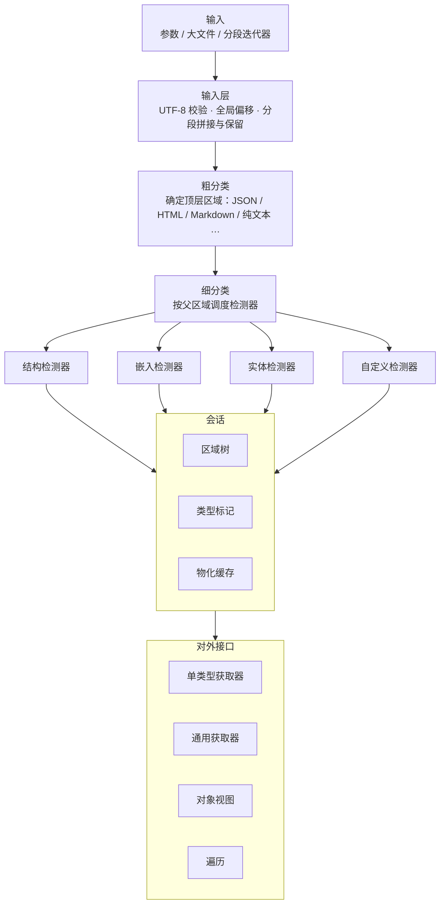

# RawPrism 设计

| 项 | 内容 |
|---|---|
| 项目 | RawPrism |
| 仓库 | `MistLoom/RawPrism` |
| 语言 | 仓颉（Cangjie） |
| cjpm 模块名 | `rawprism` |
| 文档状态 | 草案 |

## 1. 概述

RawPrism 是一个纯仓颉实现的文本扫描分类库。它读入一段文本，识别其中混合的结构化内容（JSON、YAML、HTML、XML、CSV、TOML 等）和非结构化内容（Markdown、纯文本）以及文本中的实体（URL、邮箱等），用偏移区间标出它们的位置和类型，并通过获取器按类型取出结果。

RawPrism 只读取输入，从不修改输入。所有识别结果都是对输入的区间引用。

### 1.1 目标

1. 识别文本中的结构化内容、非结构化内容和实体，输出类型化的区域树。
2. 提供单类型获取器和通用获取器，按类型或按目标格式取出结果。
3. 提供统一的对象（Object）视图，用同一套操作访问 JSON、YAML、XML/HTML DOM 等树形数据。
4. 不修改输入。
5. 同一输入中，同一类型在同一区间上只扫描一次。
6. 支持混合类型遍历和按类型遍历。
7. 支持自定义获取器，获取器之间可以嵌套。
8. 支持并发扫描，尽量减少数据复制。
9. 支持参数输入、大文件输入和分段输入。

### 1.2 非目标

1. 不处理二进制数据。图片、音视频、压缩包、PDF、Office 文档等不在输入范围内。
2. 不做内容转换。例如 HTML 转 Markdown 不是内置能力，可以由用户以自定义转换注册。
3. 不做语义分析，例如情感分析、实体消歧。
4. 不负责数据获取，例如网络请求。文件读取只用于大文件输入。

## 2. 术语

| 术语 | 定义 |
|---|---|
| 输入（Input） | 一段逻辑上连续的文本，可以一次给出，也可以分段给出 |
| 分段（Chunk） | 分段输入中的一段文本。分段边界由调用方决定，可以落在任意位置 |
| 区间（Span） | `[start, end)` 偏移对，始终相对于整个输入的起点 |
| 区域（Region） | 一个区间加上类型、置信度、属性和子区域，是分类结果的基本单元 |
| 区域树（Region Tree） | 按包含关系组织的区域树 |
| 类型（TypeId） | 层级化的类型标识，例如 `struct.json`、`markup.html`、`text.md`、`entity.url` |
| 检测器（Detector） | 在给定区间内识别某种类型并产出区域的单元 |
| 获取器（Getter） | 面向用户的接口：声明所需类型，返回区域及其物化结果 |
| 会话（Session） | 对一个输入的扫描状态容器，持有区域树、类型标记和缓存 |
| 类型标记（Mark） | 某类型在某区间上的扫描状态 |
| 对象（Object） | 统一的树形值视图，从 JSON、YAML、XML/HTML 等区域派生 |
| 物化（Materialize） | 把区域转换为目标表示，例如原文文本、对象视图、解码后的字符串值 |

## 3. 核心约束

| # | 约束 | 要求 |
|---|---|---|
| C1 | 只读 | 输入在会话内不可被修改；对外不暴露可写的输入存储；需要独立副本时由调用方显式请求 |
| C2 | 偏移稳定 | 所有区间都是相对整个输入的偏移，嵌套区域和分段输入也一样；行列号等派生位置按需计算 |
| C3 | 单次扫描 | 同一会话中，某类型在某区间上的检测至多执行一次，结果记录在类型标记中供后续获取直接使用 |
| C4 | 副产物登记 | 检测器在扫描中顺带观察到的其他类型必须登记，供对应类型的检测复用 |
| C5 | 确定性 | 相同输入和相同检测器集合产生相同的区域树和遍历顺序，与并发度、分段方式无关 |
| C6 | 惰性物化 | 区域只在被请求时物化，物化结果可缓存 |
| C7 | 资源有界 | 扫描深度、区域数量、物化大小、内存占用、时间都可设上限，超限时返回带截断标记的部分结果 |

## 4. 输入

### 4.1 输入类型

RawPrism 只接受文本输入，有三种方式：

| 方式 | 说明 |
|---|---|
| 参数输入 | 调用时直接传入整段文本 |
| 大文件输入 | 传入文件路径或可读的输入流，由 RawPrism 分段读取 |
| 分段输入 | 传入一个按顺序产出文本分段的迭代器 |

三种方式产生的结果必须一致：同一段文本无论以哪种方式输入，区域树都相同（C5）。

### 4.2 编码

- 输入文本的编码为 UTF-8。
- 输入中出现非法 UTF-8 序列时，会话按配置处理：报错，或把该区间登记为错误区域后继续扫描。
- 其他编码的文本由调用方在输入前转换为 UTF-8。
- 区间偏移以 UTF-8 字节为单位；按字符计的偏移和行列号由会话按需派生。

### 4.3 大文件输入

- 不要求把整个文件读入内存。
- 读取以分段方式进行，行为与分段输入一致（4.4）。
- 对于可按偏移重新读取的来源（例如本地文件），物化时允许按区间重新读取，而不必在内存中保留全部内容。
- 对于不可重新读取的来源（例如一次性的输入流），按分段输入的保留规则处理。

### 4.4 分段输入

分段输入用于调用方以迭代器逐段提供数据的场景。要求如下：

1. **任意边界**：分段边界可以落在任意位置，包括 UTF-8 多字节字符内部、词法单元内部（例如 JSON 字符串、HTML 标签、URL 中间）和任意结构内部。
2. **跨段结构**：跨越多个分段的结构必须被完整识别，结果与一次性输入时相同。
3. **全局偏移**：区间偏移相对整个逻辑输入，不相对单个分段。
4. **按需拉取**：会话在需要更多数据时才从迭代器取下一段，不预先读完整个迭代器。
5. **增量结果**：已经闭合的区域在输入结束前即可被遍历和获取；尚未闭合的区域标记为未完成，输入结束后确定最终状态。
6. **数据保留**：会话需要保留物化所需的数据。保留量可设上限；超出上限而无法物化的区域，在获取时明确报告不可用，不返回不完整内容。
7. **结构上限**：单个结构的最大长度可配置；结构超过上限时按 C7 截断并标注。
8. **错误传递**：迭代器产生的错误传递给调用方，已产生的结果保持有效。
9. **单向性**：会话只按顺序消费分段，不要求迭代器支持回退。

## 5. 架构



### 5.1 粗分类

粗分类确定输入的顶层区域：

| 情况 | 顶层区域 |
|---|---|
| 整体为合法 JSON | `struct.json` |
| HTML 文档 | `markup.html`，其中 `<script>`、`<style>`、`<pre>`、`<template>` 等作为子区域候选 |
| Markdown | `text.md`，其中 front matter、代码块、表格、HTML 块作为子区域候选 |
| 其他文本（日志、对话记录、混合输出等） | `text.plain`，在其中寻找嵌入的结构化片段 |

### 5.2 细分类

检测器声明它可以运行的父区域类型，调度器只在匹配的区域内运行它。示例：

```text
text.md
 ├─ struct.yaml            front matter
 ├─ code.block[lang=json]
 │   └─ struct.json
 ├─ markup.html            HTML 块
 │   └─ entity.url         href / src 属性值
 └─ text.md.paragraph
     ├─ entity.url
     └─ entity.email
```

嵌入在纯文本中的结构化片段（例如以 `{` 开头的疑似 JSON）由对应检测器做有界的试解析：成功则登记为区域，失败则登记为已检查且未命中，其他获取器不再重复检查该区间。

### 5.3 共享预扫描

多个检测器可能需要相同的底层信息，例如换行位置、括号和引号位置。会话应提供共享这类预扫描结果的机制，使同一信息在一个输入上只计算一次。具体的数据形式不在本文规定。

## 6. 内置类型

| 类别 | TypeId | 说明 |
|---|---|---|
| 结构 | `struct.json`、`struct.ndjson`、`struct.yaml`、`struct.toml`、`struct.csv`、`struct.xml` | 严格解析与有界试解析 |
| 标记 | `markup.html`，以及 `#script`、`#style`、`#text`、`.table`、`.meta` 等子类型 | 容错 HTML 解析 |
| 文本 | `text.plain`、`text.md`，以及 `.heading`、`.paragraph`、`.code`、`.table`、`.frontmatter` 等子类型 | |
| 代码 | `code.block[lang]` | Markdown 代码块、HTML `<pre><code>` 等 |
| 实体 | `entity.url`、`entity.email` 等 | 文本中的实体 |

TypeId 是层级名，选择器支持前缀匹配（例如 `text.*`）和子类型限定（例如 `markup.html#text`）。

## 7. 区域树

- 子区域必须被父区域完全包含。
- 同级区域可以重叠，重叠时必须带重叠标记，例如 URL 实体与 Markdown 链接语法。
- 支持点查询（包含某偏移的区域链）、区间查询（与某区间相交的区域）和按类型查询，查询开销不随输入总长度线性增长。
- 已发布的区域只追加、不修改，以支持并发读取。
- 区域数量较多时，区域树的内存占用应与区域数量成线性关系，不应为每个区域产生大量额外对象。

## 8. 类型标记

### 8.1 标记内容

会话为每个类型记录：

| 字段 | 含义 |
|---|---|
| 已覆盖区间 | 已检测过的区间集合，无论是否命中 |
| 状态 | 未扫描、部分扫描、已完成 |
| 区域 | 已登记的该类型区域 |
| 候选区间 | 其他检测器登记的、尚未验证的区间 |
| 否定区间 | 已验证未命中的区间 |
| 错误区间 | 检测出错的区间 |

### 8.2 获取流程

1. 请求类型 T 在区间 R 上的结果时，计算 R 中未被 T 覆盖的部分。
2. 未覆盖部分为空时，直接返回已登记的区域，不再扫描。
3. 否则只在未覆盖部分运行 T 的检测器，优先验证候选区间，完成后更新覆盖区间和状态。

### 8.3 副产物登记

检测器在扫描中天然会观察到其他类型，例如：

- JSON 检测器在读取字符串值时可以判断其是否像 URL；
- HTML 检测器解析属性时直接得到 `href`、`src` 的值区间；
- Markdown 检测器知道链接语法的位置。

检测器把这些发现登记到会话：如果检测器对该类型声明了权威性，发现直接成为区域；否则作为候选区间，由该类型的检测器验证。

## 9. 获取器

以下代码只示意接口形态，不是最终签名。接口与泛型约束的语法见 [D12][D13]。

### 9.1 基本形态

```cangjie
public interface Detector {
    prop typeId: TypeId                 // 产出的主类型
    prop within: Array<String>          // 可运行的父区域选择器，空表示整个输入
    prop dependsOn: Array<TypeId>       // 需要先完成的类型
    prop authoritative: Array<TypeId>   // 具有权威性的类型
    func detect(scope: Span, ctx: DetectContext): Unit
}

public interface Getter<T> <: Detector {
    func materialize(region: Region, ctx: MaterializeContext): T
}
```

`detect` 通过 `ctx` 读取输入、产出区域和登记副产物；`materialize` 把区域转换为目标表示。

### 9.2 单类型获取器

按具体类型获取，返回该类型的结果序列：

```cangjie
let docs = session.get<JsonDoc>()               // 全部 JSON 区域
let urls = session.get<Url>(within: "text.md")  // 限定父区域
let first = session.first<HtmlDoc>()            // 第一个，可能不存在
```

每个结果包含区域信息和惰性的值。只读取区域信息不会触发物化。

### 9.3 通用获取器

按动态类型选择获取，适用于类型在运行时才确定的场景。要求：

- 按位置顺序遍历全部区域（混合类型遍历）。
- 按类型选择器遍历区域。
- 列出输入中出现的类型及其数量、覆盖范围。
- 以目标格式取出区域：Markdown、JSON、YAML、HTML、XML、Object、Text、URL，以及自定义格式。

目标格式的规则：

- 区域本身就是目标类型时，返回原文。
- 存在无损的视图转换时返回视图，例如 JSON、YAML、XML 到 Object，HTML 到 Text（文本节点视图）。视图可以反查原文区间。
- 有损或需要生成新内容的转换不内置，由用户注册，结果标注为派生数据。

### 9.4 自定义获取器

用户可以实现获取器接口并注册到注册表。注册后的获取器与内置获取器使用方式相同，可以通过类型名获取，也会出现在混合类型遍历中。

库可以提供属性宏来减少声明代码，例如：

```cangjie
@Detector[typeId = "entity.ticket", within = ["text.*"]]
public class TicketId <: Getter<String> {
    public func detect(scope: Span, ctx: DetectContext): Unit {
        // 在 scope 内查找并 emit 区域
    }
    public func materialize(region: Region, ctx: MaterializeContext): String {
        ctx.text(region.span)
    }
}
```

不使用宏时，直接在类中实现接口的属性。宏在独立的宏包中定义。

实体类获取器通常需要模式匹配。会话应支持多个实体获取器在同一区间上共享一次扫描，而不是各自遍历一遍。

### 9.5 嵌套获取器

获取器可以读取其他类型的结果，组合出新类型。例如识别 OpenAPI 文档：

```cangjie
@Detector[typeId = "doc.openapi", dependsOn = ["struct.json", "struct.yaml"]]
public class OpenApiDoc <: Detector {
    public func detect(scope: Span, ctx: DetectContext): Unit {
        // 遍历 ctx 中已识别的 JSON / YAML 区域，
        // 顶层对象含 openapi 字段的区域 emit 为 doc.openapi
    }
}
```

要求：

- 嵌套读取同样遵守单次扫描和类型标记规则，嵌套不会引起重复扫描。
- 注册表根据依赖关系确定执行顺序，并拒绝循环依赖。

## 10. 对象模型

### 10.1 目标

`Object` 用同一套操作访问不同来源的树形数据。来源包括 JSON、YAML、XML/HTML DOM、CSV、TOML 和 front matter。

### 10.2 值

| 值 | 说明 |
|---|---|
| Null | 空值 |
| Boolean | 布尔值 |
| Number | 保留原文，按需解析为整数、浮点或高精度数值，避免精度损失 |
| Text | 原文区间；含转义时按需解码 |
| Sequence | 有序序列 |
| Mapping | 保持源顺序的键值序列，允许重复键 |

每个节点都记录来源区域、原文区间和源格式标签（例如 YAML tag、XML 元素名）。

### 10.3 映射规则

| 来源 | 映射 |
|---|---|
| JSON | 一一对应 |
| YAML | 标量按 YAML 1.2 Core Schema 推断类型；别名引用同一节点；多文档映射为 Sequence；保留 tag |
| XML / HTML DOM | 元素映射为 Mapping：属性、文本、子元素分别以约定键表示，同名子元素聚合为 Sequence，原始子节点顺序单独保留 |
| CSV | 有表头时为 Mapping 的 Sequence，否则为 Sequence 的 Sequence |
| TOML | 一一对应，日期时间保留原文并带标签 |
| front matter | 按其内部格式映射 |

映射约定（例如 XML 属性键的前缀、是否强制为序列）可以配置。

### 10.4 操作

- 按键、下标和路径访问。
- JSONPath 查询（RFC 9535）。
- 枚举键值和元素。
- 带控制（继续、跳过子树、停止）的深度遍历。
- 由节点或路径反查原文区间。
- 显式复制为不引用输入的独立结构。

`Object` 默认是引用输入的视图，不复制原文。视图可以在线程间只读共享。

## 11. 遍历

| 遍历 | 说明 |
|---|---|
| 混合类型 | 按位置顺序遍历全部区域 |
| 按类型 | 遍历某类型或某选择器匹配的区域 |
| 按层级 | 从顶层区域逐级访问子区域 |
| 限定范围 | 限定父区域类型和嵌套深度 |
| 区间查询 | 包含某偏移的区域链；与某区间相交的区域 |
| 访问者 | 进入、离开回调，进入时可以跳过子树或停止 |

遍历顺序：位置升序；起点相同时外层区域优先；再按 TypeId 字典序。

分段输入时，遍历可以在输入结束前进行，只返回已闭合的区域（4.4 第 5 条）。

## 12. 并发

RawPrism 使用仓颉线程实现并发。`spawn` 创建线程并返回 `Future<T>`，`get()` 等待结果并重新抛出线程中的异常 [D3]。

要求：

1. 相互独立的检测器可以并行执行。
2. 同一检测器在多个父区域上可以并行执行。
3. 多个会话互不影响，可以并行处理。
4. 并行度可配置上限。
5. 同一类型、同一区间的并发请求只触发一次检测，其余请求等待该次结果。
6. 合并结果与调度顺序无关（C5）。
7. 支持时间预算与取消。超时或被取消时返回已有结果并带截断标记。仓颉线程通过 `Future.cancel()` 发出取消请求，线程内通过检查取消状态响应 [D4]。
8. 检测器抛出的异常只影响该检测器在该区间的结果，记为错误区间，不影响其他检测器。
9. 提供异步扫描入口，返回 `Future`，由调用方决定何时等待。

跨线程共享的可变状态使用 `std.sync` 提供的原子类型或互斥锁保护 [D5]。

## 13. 内存与复制

要求：

1. 区域、对象节点和实体只保存区间，不复制原文。
2. 物化只在请求时进行；原文无需转换时直接以区间引用返回。
3. 需要独立副本的操作必须是显式调用，库内部不产生隐式的整段复制。
4. 获取结果对输入的引用会延长输入的存活时间；需要长期保存少量结果时，可显式复制为独立数据以释放输入。
5. 分段输入和大文件输入的内存占用由保留上限控制，不随输入总长度无界增长。

仓颉语言中可依赖的事实：

- `struct` 是值类型，赋值和传参时复制；`class` 是引用类型 [D6][D7]。
- `struct` 不能递归定义，树形结构使用 `class` 或枚举表达 [D6]。
- `Array<T>` 赋值和传参不复制元素数据；`slice` 返回原数组区间的引用，不复制；`clone` 显式复制 [D8][D9]。
- 内存由运行时垃圾回收管理 [D10]。

## 14. 健壮性

1. 解析器对嵌套深度设上限，深层嵌套输入不得导致栈溢出。
2. YAML 别名展开次数设上限，防止指数级展开。
3. XML 不解析外部实体。
4. 畸形输入不得导致整个会话失败；出错区间记为错误区间。
5. 所有检测器需要覆盖模糊测试。

## 15. 测试与基准

### 15.1 正确性

- 每种内置类型建立标注语料，统计精确率与召回率。
- 分段一致性测试：同一输入以随机分段方式输入，区域树必须与一次性输入完全相同。
- 并发一致性测试：不同并行度下区域树必须相同。
- 只读测试：扫描与物化前后输入内容不变。

### 15.2 性能

衡量指标：

- 吞吐量；
- 按输入大小分桶的延迟分位数；
- 分配次数与分配字节数；
- 峰值内存；
- 已标记类型的二次获取耗时，应与结果数量相关、与输入大小无关；
- 多核加速比。

对照基线为"每个类型各自完整扫描一遍"的实现，用于衡量单次扫描与类型标记的效果。具体数值目标在原型基准完成后确定。

语料覆盖 HTML、JSON、Markdown、YAML、混合文本，以及深度嵌套、超长字符串、非法 UTF-8 等对抗样本。

## 16. 构建

- 使用 cjpm 构建，模块名 `rawprism`。模块名同时是 root 包名 [D1]。
- 子包名与源码目录对应，例如 `rawprism.object` [D2]。
- 宏在独立的宏包中定义 [D11]。

## 17. 待定事项

以下部分的实现方式尚未确定，列出需要满足的要求。

| 事项 | 要求 |
|---|---|
| 输入存储 | 参数输入的文本以何种内部形式持有，需满足只读（C1）且不产生额外的整段复制 |
| 分段数据保留 | 在保留上限内保证跨段结构可物化；超限时的行为需可预期并可报告 |
| 大文件读取 | 不整体载入内存；可重读来源支持按区间读取 |
| 共享预扫描 | 多个检测器共享的底层扫描信息只计算一次 |
| 多实体共享匹配 | 多个实体获取器在同一区间上共享一次扫描；匹配时间对不可信输入有界 |
| HTML、XML、YAML、Markdown 解析 | 带原文偏移、容错、支持分段输入、资源有界 |
| 区域树存储 | 支持 7 节的查询，内存与区域数量成线性关系 |
| 重叠区域 | 同级重叠区域的优先级规则 |
| 置信度 | 检测器置信度的标定方法和阈值的暴露方式 |
| 结果持久化 | 区域树与类型标记是否需要序列化，以便跨会话复用 |

## 附录　仓颉资料

| 编号 | 主题 | 链接 |
|---|---|---|
| D1 | cjpm 手册 | https://docs.cangjie-lang.cn/docs/1.0.0/tools/source_zh_cn/tools/cjpm_manual_cjnative_community.html |
| D2 | 包名规则 | https://docs.cangjie-lang.cn/docs/1.0.0/user_manual/source_zh_cn/package/package_name.html |
| D3 | 创建线程：`spawn` 与 `Future<T>` | https://docs.cangjie-lang.cn/docs/1.0.0/user_manual/source_zh_cn/concurrency/use_thread.html |
| D4 | 终止线程 | https://docs.cangjie-lang.cn/docs/1.0.0/user_manual/source_zh_cn/concurrency/terminal_thread.html |
| D5 | `std.sync` | https://docs.cangjie-lang.cn/docs/1.0.0/libs/std/sync/sync_package_overview.html |
| D6 | `struct` | https://docs.cangjie-lang.cn/docs/1.0.0/user_manual/source_zh_cn/struct/define_struct.html |
| D7 | `class` | https://docs.cangjie-lang.cn/docs/1.0.0/user_manual/source_zh_cn/class_and_interface/class.html |
| D8 | `Array` | https://docs.cangjie-lang.cn/docs/1.0.0/user_manual/source_zh_cn/basic_data_type/array.html |
| D9 | `Array` API | https://docs.cangjie-lang.cn/docs/1.0.0/libs/std/core/core_package_api/core_package_structs.html |
| D10 | 白皮书 | https://docs.cangjie-lang.cn/docs/0.53.18/index.html |
| D11 | 宏 | https://docs.cangjie-lang.cn/docs/1.0.0/user_manual/source_zh_cn/Macro/macro_introduction.html |
| D12 | 接口 | https://docs.cangjie-lang.cn/docs/1.0.0/user_manual/source_zh_cn/class_and_interface/interface.html |
| D13 | 泛型约束 | https://docs.cangjie-lang.cn/docs/1.0.0/user_manual/source_zh_cn/generic/generic_constraint.html |
